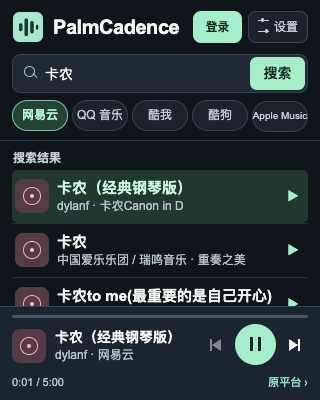
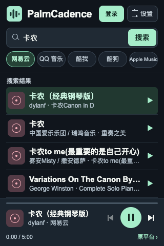
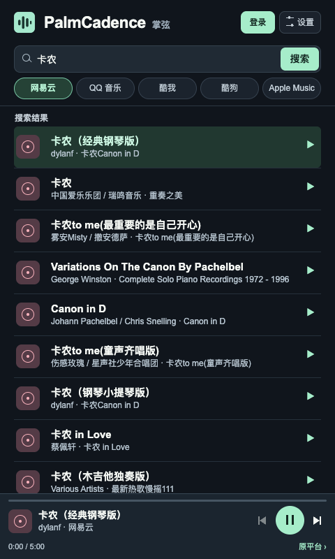
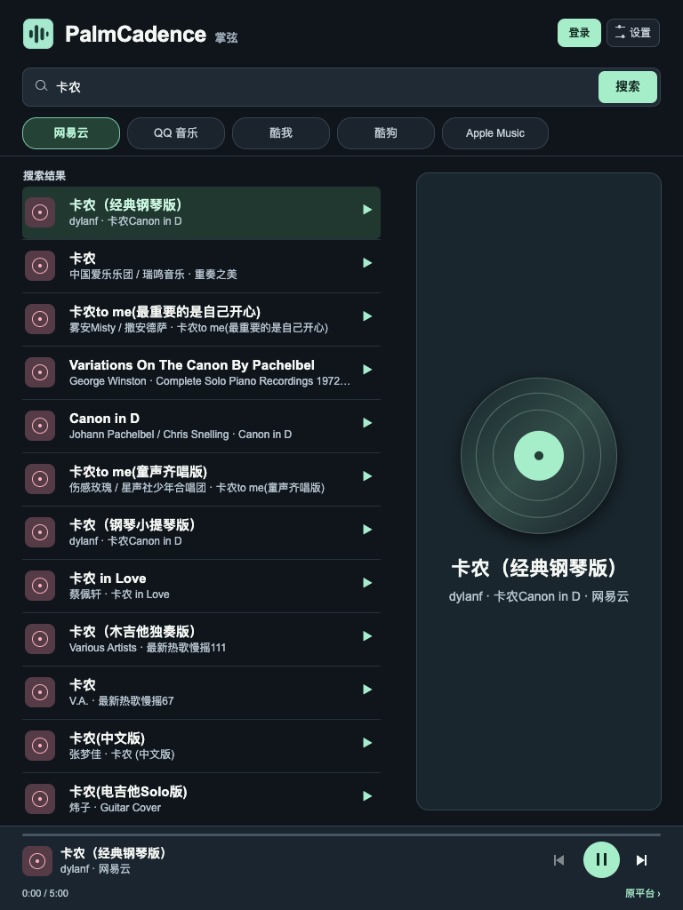
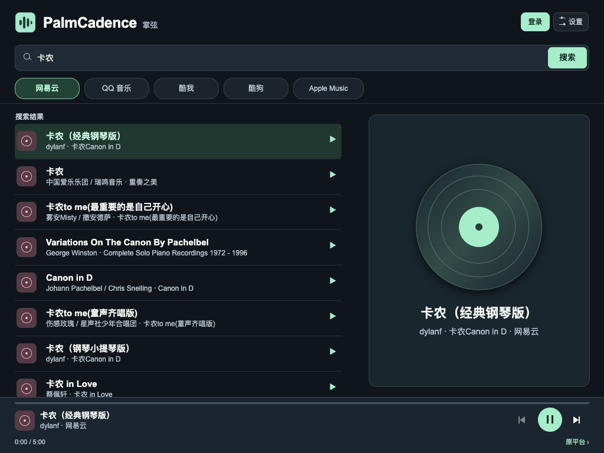
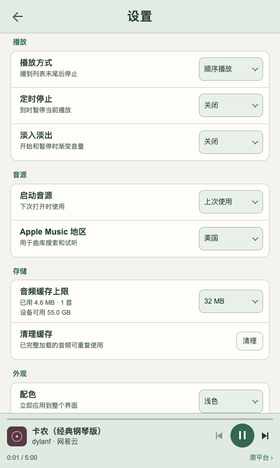
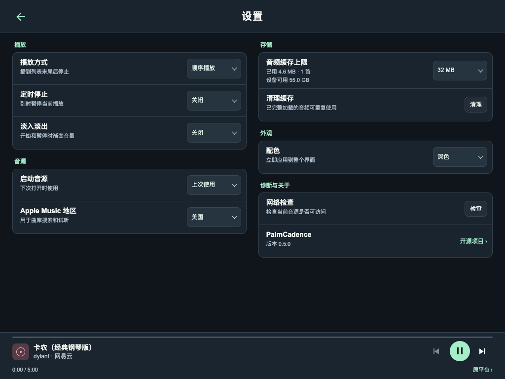
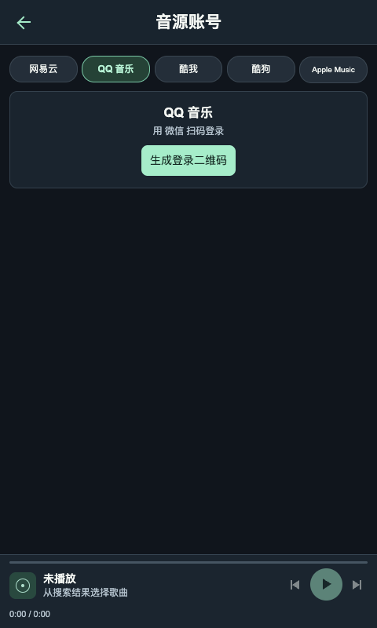

# 掌弦 · PalmCadence

给 Palm webOS 做的多音源播放器。搜歌、切换平台，也可以边浏览边播放。缩成卡片或切换应用时会保留播放状态。

点应用右上角的「设置」，也可以从 webOS 左上角的应用菜单进入。可设置播放顺序、定时停止、启动音源、Apple Music 地区和深浅配色。

首页右上角点「登录」并选择音源。网易云和酷狗用各自的音乐 App 扫码，QQ 音乐和酷我用微信扫码。登录后从「我的」打开个人歌单，播放取决于平台对当前账号和曲目的授权。

「播放」可开启淡入淡出。「存储」显示音频缓存占用和设备剩余空间，可手动清理或关闭缓存。默认上限为 32 MB，最高可设为 8 GB，缓存写入会预留 128 MB 给设备。Apple Music 试听使用流式播放。

支持 Pre、Pre 2、Pre 3、Pixi、Veer 的三种屏幕尺寸。TouchPad 横竖屏使用双栏，搜索结果和当前曲目同时显示。

## 界面截图

按对应分辨率在浏览器截取。

| 320×400 · Veer / Pixi | 320×480 · Pre / Pre 2 | 480×800 · Pre 3 |
| --- | --- | --- |
|  |  |  |

| 768×1024 · TouchPad 竖屏 | 1024×768 · TouchPad 横屏 |
| --- | --- |
|  |  |

| Pre 3 · 浅色设置 | TouchPad · 深色设置 |
| --- | --- |
|  |  |



## 音源

| 音源 | 支持情况 |
| --- | --- |
| 网易云音乐 | 搜索、播放、扫码登录、浏览个人歌单 |
| QQ 音乐、酷我 | 搜索、微信扫码、读取个人歌单，授权和播放待真实账号验证 |
| 酷狗 | 搜索、酷狗 App 扫码、读取个人歌单，授权和登录后播放待真实账号验证 |
| Apple Music | 搜索、iTunes 试听、切换地区 |

## 安装

把 `org.palmcadence.app.player_0.5.0_all.ipk` 通过 [Preware](https://github.com/webos-internals/preware) 安装到 webOS。IPK 内含 ARM 和模拟器版本，以及处理 HTTPS 的本机组件。设备联网后即可搜索和播放，无需在电脑上启动服务。

## 从源码打包

构建需要 Go、Python 3、`curl`、`patch` 和 `ar`。

```sh
./scripts/package-webos.sh
```

IPK 输出到 `dist/`。打包脚本使用 Go 1.26.11，并加入 Linux 2.6.26 所需的系统调用兼容层。

## 参考

[AlgerMusicPlayer](https://github.com/algerkong/algermusicplayer) · [Folia](https://github.com/chthollyphile/folia-major) · [见音](https://github.com/qianqianhhh2/jianyin) · [Meting](https://github.com/metowolf/Meting)

[Music-api](https://github.com/jimmyshuixin/Music-api) · [qq-music-api](https://github.com/yakult-green-tea/qq-music-api) · [KuGouMusicApi](https://github.com/MakcRe/KuGouMusicApi) · [TuneWeave](https://github.com/MOPELotus/TuneWeave)

[MIT](LICENSE) · iTunes 徽标由 Apple 提供。
